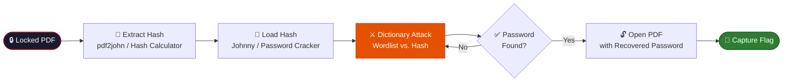

<div align="center">

<!-- ═══════════════════════════ BANNER ═══════════════════════════ -->


<a href="https://git.io/typing-svg">
  
</a>

<br/>


<br/>

### 🔓 *"Cracking passwords is all about patience and the right wordlist."*

<br/>

**[📖 Overview](#-overview)** &nbsp;•&nbsp;
**[🧰 Toolkit](#-toolkit)** &nbsp;•&nbsp;
**[🔬 Methodology](#-methodology)** &nbsp;•&nbsp;
**[🧪 Walkthroughs](#-module-walkthroughs)** &nbsp;•&nbsp;
**[🏁 Flags Captured](#-flags-captured)** &nbsp;•&nbsp;
**[📸 Evidence](#-evidence-index)**

</div>

---

## 📑 Table of Contents

<details open>
<summary><b>Click to expand / collapse</b></summary>

1. [📖 Overview](#-overview)
2. [⚖️ Legal & Ethical Disclaimer](#%EF%B8%8F-legal--ethical-disclaimer)
3. [📋 Report at a Glance](#-report-at-a-glance)
4. [🧰 Toolkit](#-toolkit)
5. [🔬 Methodology](#-methodology)
6. [🧪 Module Walkthroughs](#-module-walkthroughs)
   - [W3-PM1 — John the Ripper](#-w3-pm1--password-cracking-with-john-the-ripper-jtr)
   - [W3-PM2 — Networkwalks Tools](#-w3-pm2--password-cracking-with-networkwalks-tools)
7. [🏁 Flags Captured](#-flags-captured)
8. [📊 Overall Results](#-overall-results)
9. [📸 Evidence Index](#-evidence-index)
10. [🗂️ Repository Structure](#%EF%B8%8F-repository-structure)
11. [🚀 Getting Started](#-getting-started)
12. [🎓 Skills & Learning Outcomes](#-skills--learning-outcomes)
13. [👤 Author](#-author)
14. [📜 License & Usage](#-license--usage)

</details>

---

## 📖 Overview

This repository holds my **Week 3 Password Cracking Report** for the **Cybersecurity & Ethical Hacking** program at **Networkwalks**. It documents the complete lifecycle of recovering a password from a protected PDF file: **extracting a crackable hash, running a dictionary attack against it, and verifying the recovered password by actually opening the file.**

The exercise was approached from **two different angles** against **two separate protected PDFs**:

| 🔹 Angle | 🎯 Target | 🛠️ Tooling |
|:--------|:----------|:-----------|
| **Command-line workflow** | `My Locked PDF1.pdf` | John the Ripper (JTR) + Johnny GUI |
| **Browser-based workflow** | `My Locked PDF2.pdf` | Networkwalks Hash Calculator + Password Cracker |

> 💡 **Important:** All password recovery was performed against **protected PDF files supplied specifically for this educational lab.** No system, account or file outside that supplied material was touched at any point.

<div align="center">

### 🎯 Mission Snapshot

| 🎯 Target Files | 🧰 Tools Used | 📦 Modules | 📸 Screenshots | 🏁 Flags Captured | ✅ Success Rate |
|:---:|:---:|:---:|:---:|:---:|:---:|
| **2** | **5** | **2** | **8** | **2 / 2** | **100%** |

</div>

---

## ⚖️ Legal & Ethical Disclaimer

<table>
<tr>
<td width="60" align="center">🚨</td>
<td>

**Read this before you do anything else.**

All activities shown here were carried out **strictly inside the assigned educational cybersecurity scope**, and only against the PDF files provided or authorised for this training exercise. This material exists purely for **education and research**.

- ❌ Do **not** use anything in this repository to break the law.
- ❌ Do **not** attempt password recovery on files, systems or accounts you do not own or have explicit permission to test.
- ⚖️ Unauthorised access can be a **criminal offence**, even when no damage is caused.
- 🏫 The instructor, the authors and Networkwalks are **not responsible** for misuse of this knowledge.
- 👤 Responsibility for any action taken outside an authorised scope rests **entirely** with the person performing it.

</td>
</tr>
</table>

---

## 📋 Report at a Glance

<div align="center">

| | |
|:--|:--|
| 👤 **Pentester Name** | Shan Rasool |
| 🎓 **Program / Batch** | B083 – Networkwalks |
| 🏷️ **Report ID** | W3-PM-FINAL |
| 🎯 **Client / Target** | Protected PDF files supplied for the Networkwalks educational project |
| ✅ **Permission secured** | Yes — within the assigned educational scope, using only supplied lab materials |
| 🧭 **Phases covered** | Phase 1: Hash Extraction & Preparation <br/> Phase 2: Password Recovery <br/> Phase 3: Credential Verification & Evidence Documentation |

</div>

### 📦 Modules Completed

| Module | Topic | Focus |
|:------:|:------|:------|
| **W3-PM1** | Password Cracking with JTR | Build verification, Johnny setup, hash extraction, dictionary attack, verification |
| **W3-PM2** | Networkwalks Password Cracking Tools | Browser-based hash extraction, dictionary attack, flag capture, verification |

---

## 🧰 Toolkit

<div align="center">

| 🛠️ Tool / Material | 🎯 Purpose |
|:--------------------|:-----------|
| 🐏 **John the Ripper (JTR)** | Command-line password-recovery tool used for the dictionary attack on the extracted hash |
| 🖥️ **Johnny (GUI for JTR)** | Graphical front end used to load the hash file, launch the attack and read the recovered password |
| 🧮 **Networkwalks Hash Calculator** | Web tool that converts a password-protected PDF into a crackable `pdf2john` / `hashcat` hash |
| 🔑 **Networkwalks Password Cracker** | Browser-based dictionary-attack tool that tests a wordlist against the extracted hash |
| 📄 **Protected PDF challenge files** | `PDF1` and `PDF2` — the two password-protected target files supplied for the lab |

</div>

---

## 🔬 Methodology

Both exercises followed the same logical chain — **extract → attack → verify** — just through two different toolsets.



### 🧭 Phase Mapping

| Phase | Name | Covers |
|:-----:|:-----|:-------|
| **1** | Hash Extraction & Preparation | Build verification, uploading PDFs, extracting `$pdf$` hashes |
| **2** | Password Recovery | Running the dictionary attack with JTR / Johnny and the Networkwalks Cracker |
| **3** | Credential Verification & Evidence | Opening the PDF with the recovered password and capturing the flag |

---

## 🧪 Module Walkthroughs

### 🔹 W3-PM1 — Password Cracking with John the Ripper (JTR)

A full command-line workflow against **`My Locked PDF1.pdf`**, built around six stages:

| Step | Action | Result |
|:----:|:-------|:-------|
| 1️⃣ | Verify the JTR build | `john.exe --list=build-info` confirmed version **1.9.0-jumbo-1**, supported hash formats and crypto libraries |
| 2️⃣ | Extract the hash | Networkwalks Hash Calculator converted PDF1 into a `$pdf$` hash (`pdf2john` / `hashcat` format) |
| 3️⃣ | Load the hash | The hash was imported into **Johnny**, appearing as a single PDF-format entry with no password yet |
| 4️⃣ | Run the attack | Johnny recovered the password **`good-luck`** |
| 5️⃣ | Verify | PDF1 opened successfully with the recovered password |
| 6️⃣ | Capture | Flag **`nw{cybersecurity_flag_captured_2608}`** displayed on the confirmation screen |

<details>
<summary>💻 <b>Command reference</b></summary>

```powershell
# Confirm the John the Ripper build
.\john.exe --list=build-info

# Hash extracted via Networkwalks Hash Calculator, then loaded into Johnny
# (GUI-driven: Open password file → Start new attack → Guess password)
```

</details>

---

### 🔹 W3-PM2 — Password Cracking with Networkwalks Tools

A fully browser-based workflow against **`My Locked PDF2.pdf`**:

| Step | Action | Result |
|:----:|:-------|:-------|
| 1️⃣ | Extract the hash | Networkwalks Hash Calculator produced a `$pdf$` hash, plus PDF revision (**R4**), version (**V4**) and key length (**128-bit**) |
| 2️⃣ | Run the attack | The hash was pasted into the Networkwalks Password Cracker and tested against a built-in **100-word** wordlist |
| 3️⃣ | Crack | Tool reported **PASSWORD CRACKED SUCCESSFULLY** — recovered password: **`password1`** |
| 4️⃣ | Verify | PDF2 opened successfully with the recovered password |
| 5️⃣ | Capture | Flag **`nw{networkwalks_persistence_jtr_270521}`** displayed on the confirmation screen |

> 🧠 **Takeaway:** The browser-based tool mirrors the same underlying idea as John the Ripper — hash every candidate word and compare it to the target hash — just packaged as a guided, in-browser dictionary-attack lab.

---

## 🏁 Flags Captured

<div align="center">

| # | Module | Target | Flag |
|:-:|:------:|:-------|:-----|
| 🥇 | W3-PM1 | PDF1 | `nw{cybersecurity_flag_captured_2608}` |
| 🥈 | W3-PM2 | PDF2 | `nw{networkwalks_persistence_jtr_270521}` |

**2 / 2 flags captured — 100% completion** ✅

</div>

---

## 📊 Overall Results

<div align="center">

| Module | Tooling | Password Recovered | Verified | Flag Captured |
|:------:|:--------|:-------------------:|:--------:|:--------------:|
| **W3-PM1** | John the Ripper / Johnny | `good-luck` | ✅ | ✅ |
| **W3-PM2** | Networkwalks Hash Calculator / Cracker | `password1` | ✅ | ✅ |

</div>

Both practical modules were completed successfully. W3-PM1 demonstrated a complete **command-line** JTR workflow against PDF1, while W3-PM2 demonstrated the equivalent **browser-based** workflow against PDF2 — including password recovery, flag capture and final verification in both cases.

---

## 📸 Evidence Index

Every screenshot in the report includes a short description. The index below lists all eight, in order.

| # | Module | Evidence | What it shows |
|:-:|:------:|:---------|:--------------|
| 1 | W3-PM1 | 🖥️ JTR build and version information | Confirms the John the Ripper installation before the attack |
| 2 | W3-PM1 | 🧮 Hash extracted from PDF1 | The `$pdf$` hash produced by the Networkwalks Hash Calculator |
| 3 | W3-PM1 | 📂 PDF1 hash loaded into Johnny | The hash imported into Johnny, no password recovered yet |
| 4 | W3-PM1 | 🔓 Successful PDF1 password recovery | Johnny displays the recovered password `good-luck` |
| 5 | W3-PM1 | 🏁 PDF1 successfully verified | Confirmation screen with the first captured flag |
| 6 | W3-PM2 | 🧮 Hash extracted from PDF2 | The `$pdf$` hash plus PDF revision, version and key length |
| 7 | W3-PM2 | ⚔️ PDF2 password cracked via dictionary attack | Networkwalks Cracker reveals the recovered password `password1` |
| 8 | W3-PM2 | 🏁 PDF2 successfully verified | Confirmation screen with the second captured flag |

---

## 🗂️ Repository Structure

> A suggested layout — adjust it to match your own repository.

```text
📦 week-3-password-cracking-report
 ┣ 📜 README.md
 ┣ 📄 Week_03_Networkwalks_Password_Cracking_Report_revised.docx   ← Final report
 ┣ 📂 screenshots
 ┃ ┣ 🖼️ 01-jtr-build-info.jpg
 ┃ ┣ 🖼️ 02-pdf1-hash-extracted.jpg
 ┃ ┣ 🖼️ 03-pdf1-hash-loaded-johnny.jpg
 ┃ ┣ 🖼️ 04-pdf1-password-recovered.jpg
 ┃ ┣ 🖼️ 05-pdf1-verified-flag1.jpg
 ┃ ┣ 🖼️ 06-pdf2-hash-extracted.jpg
 ┃ ┣ 🖼️ 07-pdf2-password-cracked.jpg
 ┃ ┗ 🖼️ 08-pdf2-verified-flag2.jpg
 ┗ 📂 challenge-files
   ┣ 📄 My Locked PDF1.pdf
   ┗ 📄 My Locked PDF2.pdf
```

---

## 🚀 Getting Started

### 📥 Read the report

```bash
# 1. Clone the repository
git clone https://github.com/<your-username>/<your-repo>.git

# 2. Enter the folder
cd <your-repo>

# 3. Open the report in Word, LibreOffice or any DOCX viewer
```

### 🧪 Practise the techniques safely

If you want to repeat this kind of exercise, do it **only on files you own or have explicit permission to test**:

| ✅ Safe | ❌ Never |
|:--------|:---------|
| PDFs you created and password-protected yourself | PDFs or accounts belonging to someone else |
| Supplied lab challenge files | Production or confidential files without consent |
| Password-cracking tools in an isolated lab VM | Password-cracking tools against live, unauthorised targets |

> 📝 **Tip:** A dictionary attack is only as good as the wordlist behind it — patience and a well-chosen wordlist matter more than raw speed.

---

## 🎓 Skills & Learning Outcomes

<div align="center">

| 🧠 Skill | 📈 What I practised |
|:--------|:--------------------|
| **Hash extraction** | Converting password-protected PDFs into crackable `pdf2john` / `hashcat` hashes |
| **Command-line password cracking** | Driving John the Ripper through the Johnny GUI |
| **Browser-based password cracking** | Running a dictionary attack entirely in-browser with the Networkwalks Cracker |
| **Credential verification** | Confirming a recovered password actually unlocks the target file |
| **Evidence documentation** | Capturing each stage of an attack as traceable, reportable proof |
| **Tool comparison** | Weighing a traditional CLI workflow against a modern web-based one |
| **Ethics & scope** | Working only against files supplied and authorised for the lab |

</div>

### 💭 What I Took Away

- 🔑 The exact same **hash → attack → verify** logic underlies both a command-line tool like John the Ripper and a friendly browser-based cracker.
- 📝 A recovered password or captured flag is only meaningful in a report when it is tied to the **exact screenshot** that proves it.
- ⚖️ Password cracking is a skill that must **always** stay inside an authorised, permissioned scope.

---

## 👤 Author

<div align="center">


**Shan Rasool** &nbsp;|&nbsp; Batch **B083** &nbsp;|&nbsp; **Networkwalks**
*Cybersecurity & Ethical Hacking Program*

<br/>

[](https://github.com/)
[](https://www.linkedin.com/)
[](mailto:your-email@example.com)

</div>

> ✏️ *Replace the GitHub, LinkedIn and email links above with your own.*

---

## 📜 License & Usage

This project is shared for **educational and research purposes only**.

- ✅ You may read, learn from and reference this report with credit.
- ❌ You may not use it to crack passwords on any file, system or account without explicit authorisation.
- ⚖️ The author and Networkwalks accept no liability for misuse.

---

<div align="center">

### ⭐ If this report helped you learn, consider giving the repo a star!

**Stay curious. Stay ethical. Stay authorised.** 🔐


</div>
